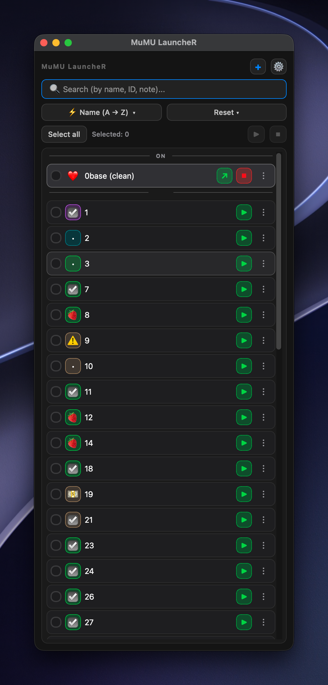
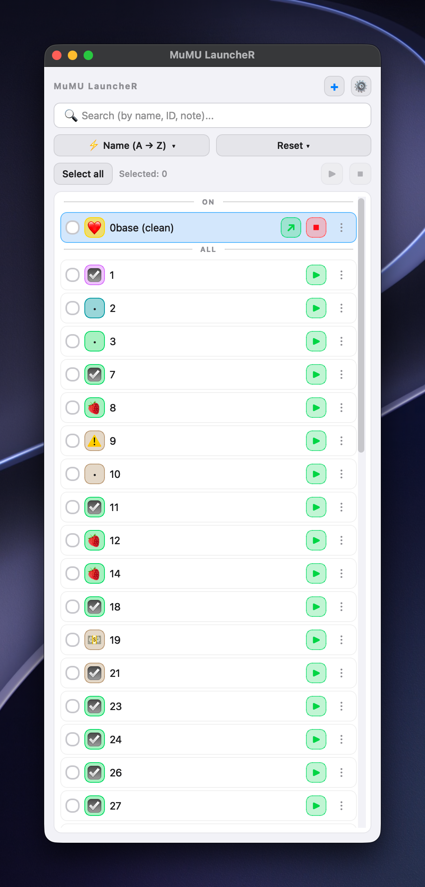
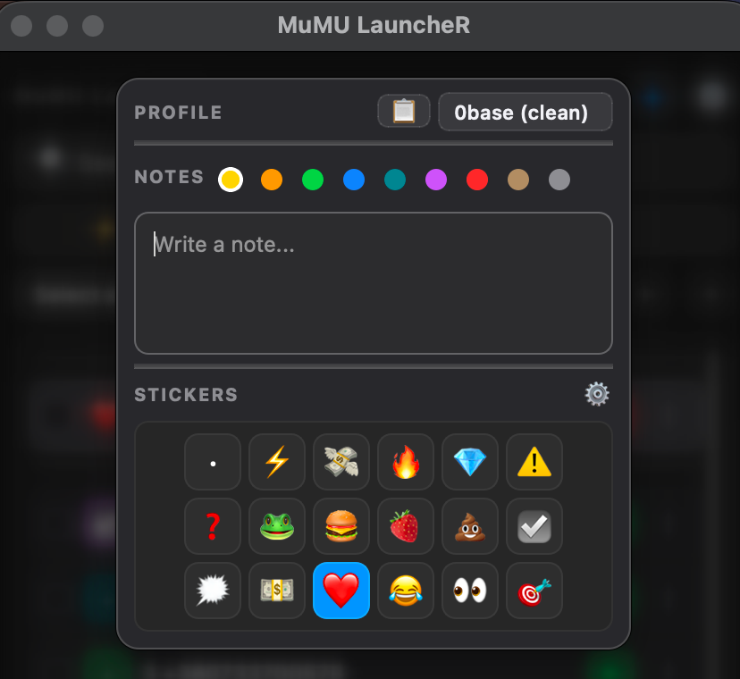
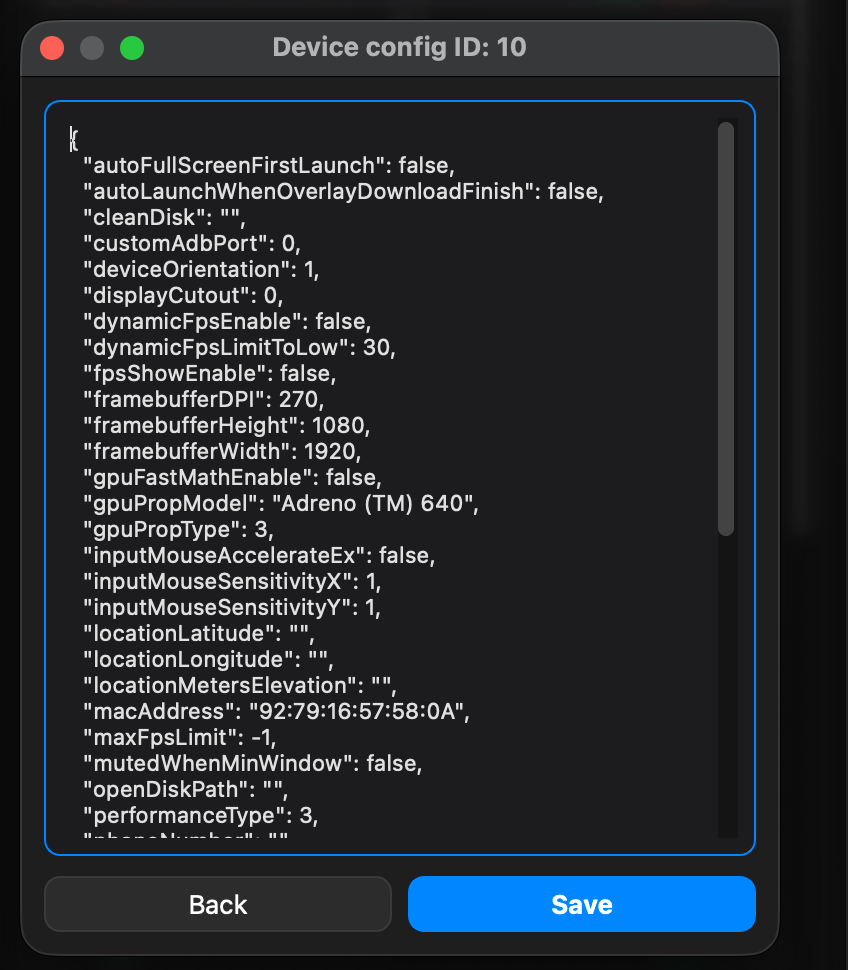

<div align="center">

# 🚀 MuMU LauncheR

**Хватит кликать по MuMuPlayer по одному профилю.**
Запускай, останавливай, клонируй, настраивай и организуй десятки профилей MuMuPlayer Pro из одного быстрого и аккуратного окна.


[English](README.md) · [Русский](README.ru.md)



</div>

---

## Зачем это нужно

Если у тебя больше пары эмуляторов, ты знаешь эту боль: открыть менеджер, найти нужный профиль, подождать, повторить. **MuMU LauncheR** превращает всё это в одну панель управления для тех, кто работает с *множеством* профилей.

- ⚡ **Запуск 20 профилей в пару кликов**: отметил, нажал, готово.
- 🧠 **Умная очередь запуска**: если MuMuPlayer закрыт, лаунчер сам его откроет, дождётся *полной* готовности и запустит профили по очереди с безопасной паузой.
- 🗂️ **Ничего не потеряется**: цветные заметки, эмодзи-стикеры, поиск по имени, ID и тексту заметки.
- 🛠️ **Массовый конфиг**: меняй разрешение, DPI, CPU и RAM **сразу у всех профилей**.
- 🌍 **16 языков**, тёмная и светлая темы, один код для **Windows и macOS**.

---

## Возможности

### Запуск и управление
- **Запуск по галочкам**: отметь нужные профили и запусти или останови их одной кнопкой
- **Умная очередь**: сама открывает MuMuPlayer в свёрнутом виде, ждёт полной готовности, запускает профили с паузой 0.5 сек
- **Самовосстановление**: если после «холодного» старта профиль не поднялся, команда открытия отправляется повторно
- **Честный Stop**: останавливает ещё и очередь запуска, профили не продолжат стартовать после нажатия
- **Закрыть все**: одна кнопка гасит все запущенные профили
- **Статус в реальном времени**: состояние профилей обновляется дважды в секунду

### Организация
- **Умные секции**: список делится на `ВКЛ`, `ВСЕ`, `ВКЛ (ПОИСК)` и `ПОИСК`
- **Мгновенный поиск**: по имени, ID **и тексту заметки**
- **Сортировка**: имя А→Я / Я→А, ID 0→9 / 9→0 и переключатель «Всегда сначала запущенные»
- **Цветные заметки**: заметка к любому профилю, 9 цветов, автосохранение
- **Стикеры**: 18 готовых эмодзи, можно добавлять свои, менять порядок и назначать основной

### Управление устройствами
- **Создание**: новый **Планшет 2560 × 1440** или **Телефон 1440 × 2560** в один клик
- **Клон / Удаление**: с подтверждением, запущенное устройство сначала корректно выключается
- **Редактор конфига**: JSON отдельного профиля с проверкой на валидность
- **Массовый конфиг**: вставь кусок конфига один раз и примени ко всем профилям

### Удобство
- 🌗 Тёмная и светлая темы
- 📌 Режим «Поверх всех»
- 🌐 16 языков с поиском по языку
- 💾 Галочки, заметки, цвета и стикеры сохраняются автоматически

---

## Скриншоты

<table>
  <tr>
    <td align="center"><br><sub>Главное окно, тёмная тема</sub></td>
    <td align="center"><br><sub>Светлая тема</sub></td>
  </tr>
  <tr>
    <td align="center"><br><sub>Цветные заметки и стикеры</sub></td>
    <td align="center"><br><sub>Массовый конфиг</sub></td>
  </tr>
</table>

---

## Установка

**Нужно:** Python 3.9+ и установленный [MuMuPlayer Pro](https://www.mumuplayer.com/).

```bash
git clone https://github.com/clickrisk/MuMU-LauncheR.git
cd MuMU-LauncheR
pip install -r requirements.txt
```

**Windows:**

```bash
python windows/mumu_launcher_win.py
```

Лаунчер сам находит `MuMuManager.exe` в стандартных папках установки. Если MuMuPlayer лежит в необычном месте, укажи путь переменной окружения:

```bat
set MUMU_MANAGER=D:\Games\MuMuPlayer\nx_main\MuMuManager.exe
```

Настройки хранятся в `%APPDATA%\MuMu Launcher\config.json`.

**macOS:**

```bash
python3 macos/mumu_launcher.py
```

---

## Быстрый старт

1. Запусти приложение, профили MuMuPlayer подтянутся сами.
2. Отметь нужные и нажми **Запустить**.
3. Кликни на стикер профиля: добавь **заметку**, выбери **цвет** или **стикер**.
4. В **⚙ Настройках** меняются тема, язык и режим «Поверх всех».
5. Нужно одно разрешение на всех профилях? Открой **Изменить конфиг всех профилей**, вставь фрагмент и примени:

```json
"resolution_mode": "custom",
"resolution_width.custom": "1280",
"resolution_height.custom": "720",
"resolution_dpi.custom": "180"
```

> ⚠️ Запущенные устройства автоматически выключаются перед сменой конфига: MuMuPlayer применяет его только к остановленным профилям.

---

## Участие в проекте

Issues, идеи и pull request-ы приветствуются. Если лаунчер сэкономил тебе время, поставь ⭐ репозиторию.

## Лицензия

[MIT](LICENSE)

<div align="center">

Сделано с ❤️ — **[@clickrisk](https://github.com/clickrisk)**

</div>
